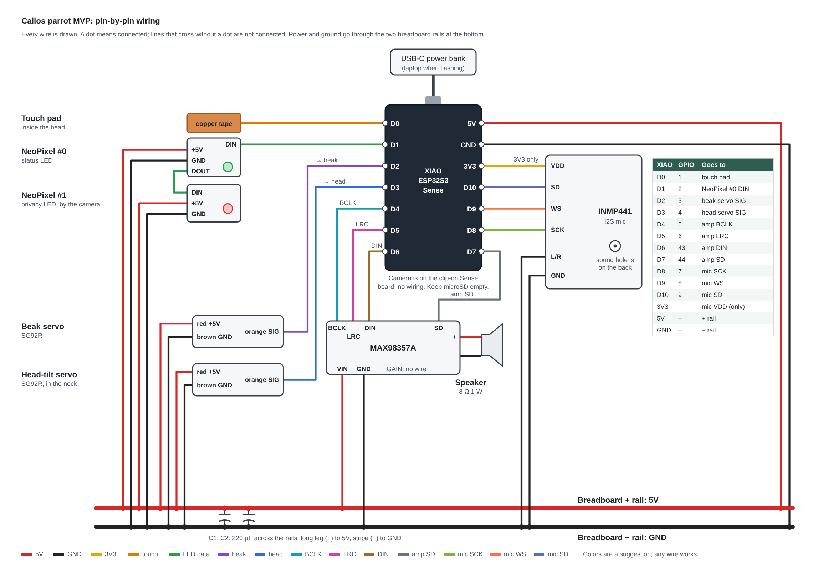

# Calios parrot MVP: wiring

This covers the stage-1 MVP: a XIAO ESP32S3 Sense, an INMP441 microphone, a MAX98357A amp and speaker, two SG92R servos (beak and head tilt), two NeoPixels (status and camera-privacy), and a copper-tape touch pad, all powered from a USB-C power bank.

The diagram draws every wire, including power and ground. A dot means connected; lines that cross without a dot are not connected.

## Pin map

| XIAO pin | GPIO | Connects to | What it does |
|---|---|---|---|
| D0 | GPIO1 | Copper-tape touch pad (or a button to GND) | Tap the head to talk. GPIO1 is capacitive touch channel 1. |
| D1 | GPIO2 | NeoPixel #0 **DIN** | Status LED. NeoPixel #0 **DOUT** goes on to NeoPixel #1 **DIN** (privacy LED). |
| D2 | GPIO3 | Beak servo, orange wire | Beak opens with the voice. |
| D3 | GPIO4 | Head-tilt servo, orange wire | Head tilts and sways to show mood. |
| D4 | GPIO5 | MAX98357A **BCLK** | I2S bit clock |
| D5 | GPIO6 | MAX98357A **LRC** | I2S word select |
| D6 | GPIO43 | MAX98357A **DIN** | I2S audio data |
| D7 | GPIO44 | MAX98357A **SD** | Amp on/off. The firmware switches it off after 2 s of silence, which removes hiss. |
| D8 | GPIO7 | INMP441 **SCK** | Mic bit clock |
| D9 | GPIO8 | INMP441 **WS** | Mic word select |
| D10 | GPIO9 | INMP441 **SD** | Mic audio data |
| 3V3 | – | INMP441 **VDD** | The mic is a 3.3 V part. Never connect it to 5 V. |
| 5V | – | Breadboard **+ rail** | USB power from the power bank. |
| GND | – | Breadboard **− rail** | |

D8–D10 are shared with the Sense board's microSD slot, so keep the slot empty.

On the Sense board (clips onto the XIAO, no wiring):

| Part | Pins |
|---|---|
| PDM microphone (only if you pick the onboard mic in menuconfig) | CLK GPIO42, DATA GPIO41 |
| Camera (OV2640 / OV3660) | XCLK 10, SDA 40, SCL 39, D0–D7 = 15, 17, 18, 16, 14, 12, 11, 48, VSYNC 38, HREF 47, PCLK 13 |

The firmware's copy of this table is `main/board.h`. If you move a wire, change it there too.

## Connections, part by part

### Power

1. Power bank → USB-C on the XIAO. Use a port that supplies at least 2 A.
2. XIAO **5V** → breadboard **+ rail**. XIAO **GND** → breadboard **− rail**.
3. Two **220 µF** capacitors across 5V and GND, one right next to where each servo gets its power. On the desk that's side by side on the rails; once the beak servo moves into the head, take one cap with it. The long leg goes to **+**, and the side with the stripe goes to **−**. They absorb the current spikes when a servo starts moving.

The MiniBoost and the slide switch from the parts list aren't needed with a power bank. The bank already supplies 5 V, and unplugging it turns the parrot off.

### Speaker amp (MAX98357A)

| Amp pin | Goes to |
|---|---|
| Vin | + rail (5V) |
| GND | − rail |
| BCLK | D4 |
| LRC | D5 |
| DIN | D6 |
| SD | D7 |
| GAIN | Leave unconnected (9 dB). Volume is set in software. |
| Speaker + / − | Speaker wires, in the screw terminal |

The amp can push more power than the 1 W speaker is rated for. The firmware defaults to 50% volume. Raise it in menuconfig a little at a time.

### Servos (SG92R ×2)

Each servo has a 3-wire plug: **brown = GND**, **red = 5V**, **orange = signal**. Push male-to-male jumpers into the plug, or a 3-pin header into the breadboard.

| Servo | Brown | Red | Orange |
|---|---|---|---|
| Beak | − rail | + rail | D2 |
| Head tilt | − rail | + rail | D3 |

Before you attach the beak linkage, flash the firmware once and let the servos move to their start positions (90°). Then fit the horns, so "closed" and "straight" really are closed and straight. Fine-tune the angles in menuconfig → Calios parrot → Servos. If the beak is mounted so that opening means a smaller angle, set the open angle below the closed angle; that works too.

Make sure the beak can't hit a hard stop at either end. A servo pushing against a stop stalls and draws 600 mA or more, which can reset the board.

### NeoPixels (2 × mini button PCB)

These are tiny, so you'll solder thin wires to their pads.

| Pad | NeoPixel #0 (status) | NeoPixel #1 (privacy) |
|---|---|---|
| + (5V) | + rail | + rail |
| − (GND) | − rail | − rail |
| Data in | D1 | NeoPixel #0 data out |

Put #0 where people can see it (the chest or the back of the head) and #1 right next to the camera lens.

The XIAO's data signal is 3.3 V and the LEDs run on 5 V, which normally works with short wires. If the colors flicker or come out wrong, move the LEDs' + wires from the 5 V rail to the XIAO's **3V3** pin. They get a bit dimmer but stay reliable.

### Microphone (INMP441)

| Mic pin | Goes to |
|---|---|
| VDD | XIAO **3V3** (not the 5 V rail) |
| GND | − rail |
| L/R | − rail (selects the left channel, which the firmware reads) |
| WS | D9 |
| SCK | D8 |
| SD | D10 |

- The sound hole is on the **back** of most INMP441 boards, through the PCB. Face that side toward the wearer's mouth.
- The firmware uses this mic by default. To go back to the Sense board's built-in mic, set menuconfig → Calios parrot → Audio → **Microphone** to onboard.
- When it starts, the log should show `mic: external INMP441 on GPIO7/8/9, gain 24x`. If the parrot never hears you, check SCK/WS/SD aren't swapped and L/R is grounded. If it hears you but cuts in on background noise, lower **External mic gain**.

### Touch pad (copper tape)

1. Stick a piece of copper tape about 2 × 2 cm on the **inside** of the head shell, where you'd tap.
2. Solder a wire to the tape, or press a stripped wire end under it, and run the wire to **D0**.
3. Keep this wire short (under 15 cm) and away from the servo wires.

For desk testing, a bare jumper end works as the pad. To tune it through the shell, turn on menuconfig → Head input → **Print touch readings**, watch how much the reading rises when you touch the head, and set the threshold to about half of that rise.

If touch gives you trouble, wire a push button from D0 to GND and pick **Push button** in menuconfig.

### Microphone and camera

Both are on the Sense board, so there's nothing to wire. Placement still matters:

- **Mic:** mount the INMP441 in the side of the head that faces the wearer, with its sound hole toward their mouth, and keep the speaker at the other end of the body facing outward. The parrot doesn't listen while it's talking, but less echo means fewer false starts.
- **Camera:** the camera can look out one eye hole, since the eye screens aren't in the MVP. That puts the XIAO in the head, with a 7-wire bundle running down to the breadboard in the body: 5V, GND, D3 (head-tilt servo, which sits in the neck), and D4–D7 (amp). The beak servo, touch pad, NeoPixels, and mic are in the head too, so their wires stay short; the servo and LEDs take 5V and GND from the bundle, and the mic takes 3V3 straight from the XIAO. The power bank cable then plugs into the XIAO's USB-C port in the back of the head. Use soft silicone jumper wire for the bundle so the head can still tilt.

## Suggested build order

1. **Desk test, XIAO on the breadboard.** Wire power and the amp first, flash the firmware, and check that you hear the startup chirp once it connects.
2. Add the mic and the touch pad (or a bare wire) and have a conversation.
3. Add the servos with nothing attached and watch them move while it talks.
4. Add the NeoPixels.
5. **Move into the body:** XIAO into the head with the 7-wire bundle, breadboard and caps in the body, speaker facing out of the chest.

## Power budget (estimates)

| Part | Typical | Peak |
|---|---|---|
| XIAO + Wi-Fi streaming | 100–150 mA | ~350 mA |
| Camera (always running) | ~80 mA | ~100 mA |
| Amp + speaker at 50% | 50–150 mA | ~300 mA |
| Servos, moving | 100–250 mA each | 600 mA+ each if stalled |
| NeoPixels at default brightness | ~15 mA | ~40 mA |
| INMP441 mic | ~1.5 mA | ~1.5 mA |
| **Total** | **~0.5–0.8 A** | **~1.5 A** |

A 5,000 mAh power bank should run it for a few hours of active conversation. These numbers are estimates, not measurements, so check with your USB power meter.

**If the board resets when the servos move**, the 5V pin can't keep up with the spikes. The fix is to feed the **+ rail** from a second power-bank port (a USB-C breakout or a cut USB cable) and **remove the wire from the XIAO 5V pin to the rail**. Keep the grounds connected. Never connect two different 5 V sources together.

**When flashing from a laptop**, the servos run off the laptop's USB port. If it struggles, pull the + rail jumper while flashing.
